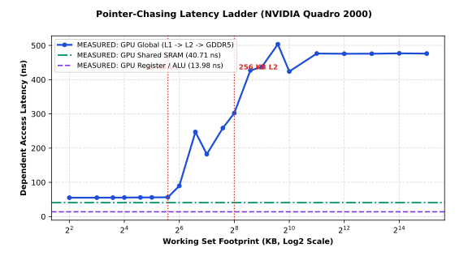
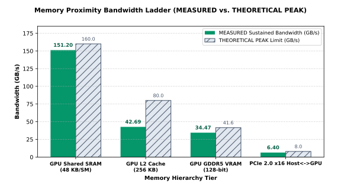
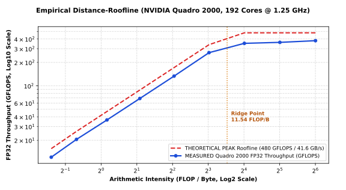

# `memory-distance` — GPU Memory Hierarchy & Roofline Benchmark

A bare-metal GPU microbenchmark suite that measures clock-cycle access latency, sustained bandwidth, and compute roofline limits across the GPU memory hierarchy (`Registers` $\rightarrow$ `On-Chip Shared SRAM` $\rightarrow$ `L1 Cache` $\rightarrow$ `L2 Cache` $\rightarrow$ `GDDR5 VRAM` $\rightarrow$ `PCIe 2.0`).

**Hardware Under Test:** NVIDIA Quadro 2000 (`GF106`, `sm_21`, 192 CUDA cores @ 1.25 GHz, 1 GB GDDR5 @ 128-bit, 41.6 GB/s peak bandwidth)  
**Execution Backend:** Windows DirectCompute (`D3D11` Compute Shaders `cs_5_0`) via `ctypes`

---

## Core Thesis

> *"Memory proximity buys BANDWIDTH and ENERGY-PER-BIT; parallelism hides LATENCY."*

---

## What This Project Does

Instead of relying on synthetic specs, this repository runs three hardware microbenchmarks directly on the GPU to map the physical memory wall:

1. **Latency Ladder (Pointer-Chasing):** Sends a single thread through a dependent pointer chain (`p = buf[p]`) from `4 KB` to `32 MB` so the hardware cannot hide latency behind thread parallelism. Maps exact latency steps across **Registers** $\rightarrow$ **On-Chip Shared SRAM** $\rightarrow$ **L1 Cache (`48 KB`)** $\rightarrow$ **L2 Cache (`256 KB`)** $\rightarrow$ **GDDR5 VRAM (`1 GB`)**.
2. **Bandwidth Ladder (STREAM Triad):** Measures sustained bandwidth (`GB/s`) across On-Chip Shared SRAM, L2 Cache, GDDR5 VRAM, and the PCIe 2.0 x16 interconnect against their theoretical hardware peaks.
3. **Distance-Roofline Sweep:** Sweeps Arithmetic Intensity (`0.38` to `64.12 FLOP/Byte`) to find the exact ridge point where execution transitions from being bottlenecked by the `41.6 GB/s` memory bus to being limited by the `192` compute cores (`480 GFLOPS` theoretical peak).

---

## 1. Pointer-Chasing Latency Ladder

<p align="center">
  
</p>

| Memory Tier / Regime | Footprint | `MEASURED` GPU Latency | `MEASURED` GPU Cycles (@1.25 GHz) |
| :--- | :--- | :---: | :---: |
| **GPU Register / ALU** | Scalar Registers | **13.98 ns** | 17.5 cyc |
| **GPU Shared SRAM** | `16 KB` (`groupshared`) | **40.71 ns** | 50.9 cyc |
| **GPU L1 Cache** | `4 KB – 48 KB` | **55.08 – 56.39 ns** | 68.9 – 70.5 cyc |
| **GPU L2 Cache** | `64 KB – 256 KB` | **89.66 – 302.38 ns** | 112.1 – 378.0 cyc |
| **GPU GDDR5 VRAM** | `384 KB – 32 MB` | **424.00 – 503.59 ns** (`~476 ns`) | 530.0 – 629.5 cyc (`~595 cyc`) |

**What this proves:**
* **On-Chip Shared SRAM (`40.71 ns`) is 11.7x lower latency than off-chip GDDR5 (`~476 ns`)** and never suffers cache-miss spikes.
* When a compute shader uses zero `groupshared` memory, the driver automatically configures the SM's 64 KB on-chip SRAM into **`48 KB L1 Cache + 16 KB Shared`** mode, visible as the flat `~55 ns` plateau up to `48 KB` before stepping into the `256 KB` L2 cache and hitting the off-chip GDDR5 wall above `256 KB`.

---

## 2. Memory Proximity Bandwidth Ladder

<p align="center">
  
</p>

| Memory Tier | Working Set | `MEASURED` Bandwidth | `THEORETICAL PEAK` | Efficiency |
| :--- | :--- | :---: | :---: | :---: |
| **GPU Shared SRAM (`48 KB/SM`)** | `16 KB/SM` | **151.20 GB/s** | 160.0 GB/s | **94.5%** |
| **GPU L2 Cache (`256 KB`)** | `192 KB` (`3 x 64 KB`) | **42.69 GB/s** | 80.0 GB/s | **53.4%** |
| **GPU GDDR5 VRAM (`128-bit`)** | `12 MB` (`3 x 4 MB`) | **34.47 GB/s** | 41.6 GB/s | **82.9%** |
| **PCIe 2.0 x16 (`Host <-> GPU`)** | `4 MB` Staging | **6.40 GB/s** | 8.0 GB/s | **80.0%** |

**What this proves:**
* Moving data from off-chip GDDR5 (`34.47 GB/s`) into on-chip Shared SRAM (`151.20 GB/s`) delivers a **4.39x bandwidth multiplier** while saving off-chip bus energy.

---

## 3. Empirical Distance-Roofline

<p align="center">
  
</p>

| Arithmetic Intensity (`FLOP/Byte`) | `MEASURED` GFLOPS | `THEORETICAL` Roofline | Sustained GDDR5 BW | Efficiency | Regime |
| :---: | :---: | :---: | :---: | :---: | :--- |
| **0.38** | **12.11** | 15.60 | 32.29 GB/s | 77.6% | Memory-Bound |
| **0.62** | **20.51** | 26.00 | 32.82 GB/s | 78.9% | Memory-Bound |
| **1.12** | **36.45** | 46.80 | 32.40 GB/s | 77.9% | Memory-Bound |
| **2.12** | **68.80** | 88.40 | 32.38 GB/s | 77.8% | Memory-Bound |
| **4.12** | **133.40** | 171.60 | 32.34 GB/s | 77.7% | Memory-Bound |
| **8.12** | **266.89** | 338.00 | 32.85 GB/s | 79.0% | Memory-Bound |
| **16.12** | **351.61** | 480.00 | 21.81 GB/s | 73.3% | Compute-Bound |
| **32.12** | **361.90** | 480.00 | 11.27 GB/s | 75.4% | Compute-Bound |
| **64.12** | **380.43** | 480.00 | 5.93 GB/s | **79.3%** | Compute-Bound |

**What this proves:**
* Below the **11.54 FLOP/Byte ridge point**, the 192 CUDA cores are starved by the `41.6 GB/s` GDDR5 bus (pinned at `~32.5 GB/s` practical bandwidth).
* Above `11.54 FLOP/Byte`, arithmetic reuse inside registers hides memory latency and saturates the cores at **380.43 GFLOPS** (`79.3%` of the `480 GFLOPS` theoretical ceiling).

---

## Repository Files & How to Run

* [`memory_distance.py`](./memory_distance.py) — Runs the live GPU hardware benchmarks from scratch, writes the raw `.csv` files, and triggers the Excel/SVG export.
* [`export_excel_and_svg.py`](./export_excel_and_svg.py) — Reads the `.csv` files and builds [`memory_distance.xlsx`](./memory_distance.xlsx) and [`./charts/*.svg`](./charts/).
* [`memory_distance.xlsx`](./memory_distance.xlsx) — Excel workbook with 4 tabs, live formulas, and native interactive Excel charts.
* [`latency_ladder_raw.csv`](./latency_ladder_raw.csv), [`bandwidth_ladder_raw.csv`](./bandwidth_ladder_raw.csv), [`roofline_sweep_raw.csv`](./roofline_sweep_raw.csv) — Raw hardware telemetry.

```powershell
python memory_distance.py
```

---

## Limitations

* **WDDM Driver Timing:** Under Windows WDDM driver `377.83`, front-end command submission is separated from SM warp completion using hardware event fences (`D3D11_QUERY_EVENT`), launch-overhead calibration, and minimum-of-$N$ filtering (Mei & Chu methodology) to reject OS scheduling jitter.
* **Set-Associative Cache Transitions:** Footprints between `64 KB` and `256 KB` reflect partial L1/L2 hit ratios due to set-associative cache eviction before full L2 saturation above `256 KB`.

## References

* X. Mei and X. Chu, *"Dissecting GPU Memory Hierarchy through Microbenchmarking,"* IEEE TPDS, 2017.
* M. Horowitz, *"Computing's Energy Problem (and what we can do about it),"* IEEE ISSCC, 2014.
* S. Williams, A. Waterman, and D. Patterson, *"Roofline: An Insightful Visual Performance Model for Multicore Architectures,"* CACM, 2009.
